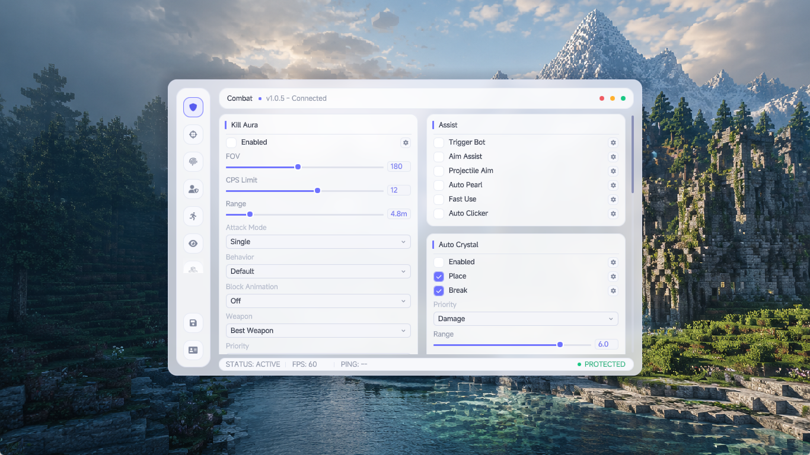
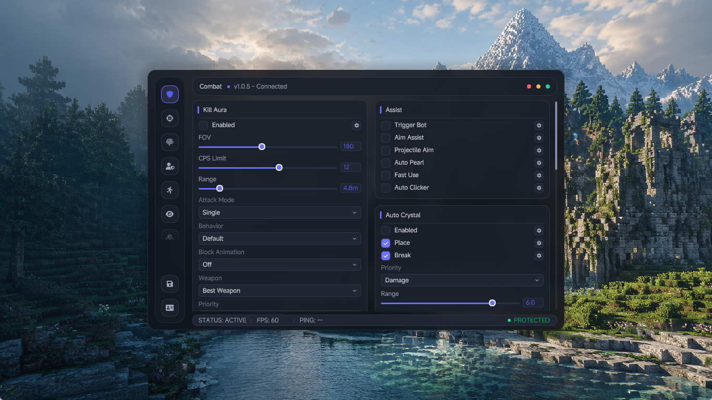
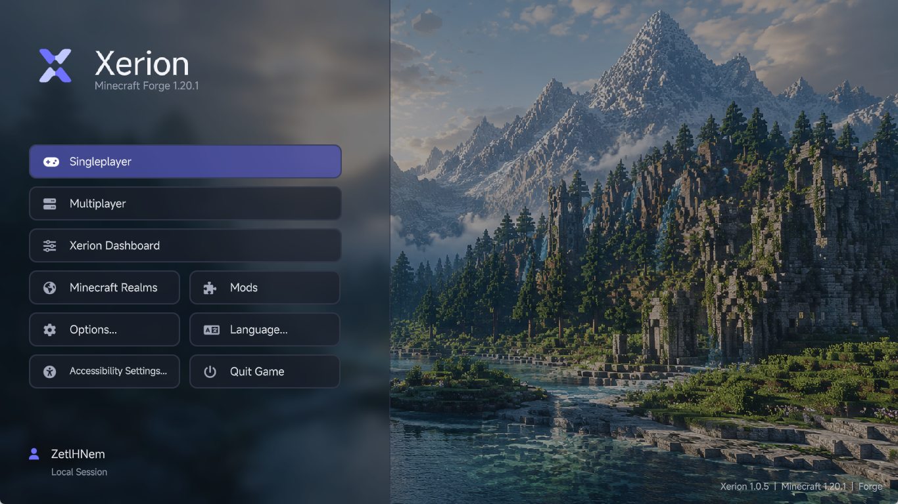
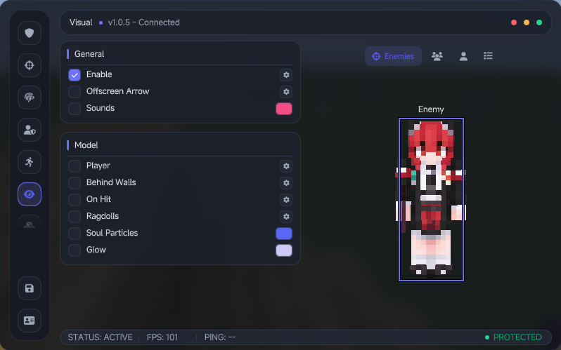

<div align="center">


<h1>Xerion</h1>

<p>A modular <b>Minecraft 1.20.1 Forge</b> mod focused on PvP combat, movement,<br />
visual and world utility modules.</p>

<p>
  
  
  
</p>

<p><sub>Xerion —— Minecraft 1.20.1 Forge 模组：以 PvP 战斗、移动、视觉与世界功能模块为核心，配套自研游戏内面板 UI。</sub></p>

</div>

> [!WARNING]
> **This project is no longer maintained.** No further updates, bug fixes or support will be
> provided; the code is published as-is for reference.
>
> **本项目已停止维护与更新**，不再更新、修复或提供支持，代码按现状仅供查阅。

---

## Feature modules

Every feature is an independent module with its own settings and hotkey binding.
Module state and settings are persisted through the config store.

| Category | Modules |
| :------- | :------ |
| **Combat** | Kill Aura · Criticals · Knockback · WTap · Reach · Backtrack · Fake Lag · Velocity · Auto Crystal · Bed Aura · Anchor Aura · Web Aura · Auto Trap · Surround · Hole Fill |
| **Movement** | Speed · Flight · Elytra Fly · Step · Long Jump · High Jump · Jesus · Spider · Scaffold · Blink · Stuck · No Slow · Safe Walk |
| **Visual / ESP** | ESP · Xray · Chams · Freecam · Zoom · Fullbright · No Fog · Time Changer · View Model |
| **World** | Auto Mine · Nuker · Vein Miner · Breaker · Fast Break · Fast Web |
| **Player** | Auto Totem · Auto Armor · Auto Heal · Auto Pearl · Auto EXP · Auto Weapon · Chest Steal · Inventory Cleaner |
| **Compatibility** | Compatibility · Disabler · Ping Spoof · No Rotate |

## Screenshots

| Dashboard · light theme | Dashboard · dark theme |
| :---: | :---: |
|  |  |

| Title screen | Visual / Chams settings |
| :---: | :---: |
|  |  |

## Components

| Component | Description |
| :-------- | :---------- |
| **In-game dashboard** | Immediate-mode UI for browsing modules, editing settings and managing profiles, rendered with custom shader primitives. |
| **Rendering pipeline** | Shared render abstractions and custom shaders for overlays, glow, chams and post-processing. |
| **Mixin layer** | A single Forge mixin package wires the modules into client, network and render entry points (1.20.1 SRG member names). |
| **Loader-agnostic core** | `common` has no Minecraft or Forge imports; the Forge module translates platform events into the shared event model. |

## Repository layout

```text
Xerion
├── common/        loader-free core: modules, events, render abstractions, state, config models
├── forge/         Forge @Mod entry point, event adapters, mixins, client implementation
├── screenshots/   README screen captures
└── tools/         font / atlas generation helpers used by the UI
```

## Build

**Requirements**

- JDK 17
- A Forge 1.20.1 development environment

**Dependencies**

Embeddium and TaCZ are compile-time integrations and are not bundled. Gradle resolves
them from Modrinth; for offline builds place the jars in `libs/`:

```text
libs/embeddium-0.3.31+mc1.20.1.jar
libs/tacz-1.20.1-1.1.8-hotfix.jar
```

or pass `-PembeddiumJar=/path/to/jar -PtaczJar=/path/to/jar`.

**Build**

```bash
./gradlew :forge:build
```

**Install**

Copy `forge/build/libs/xerion-forge-<version>.jar` into `.minecraft/mods` of a
1.20.1 Forge 47.x instance.

## Development notes

- `common` intentionally has no Minecraft or Forge imports; platform events are
  translated by the Forge adapter and rendering is exposed through `RenderContext`.
- Mixin targets use 1.20.1 SRG member names (`m_…_` / `f_…_`) because the mod is built
  for the production runtime.
